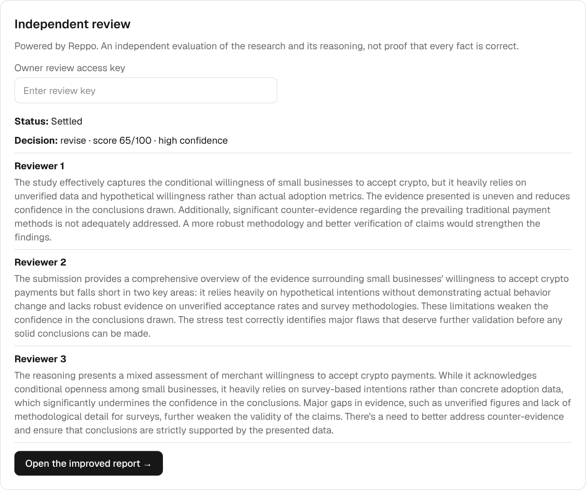
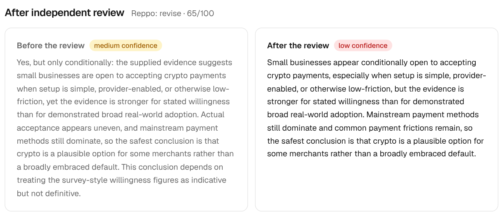
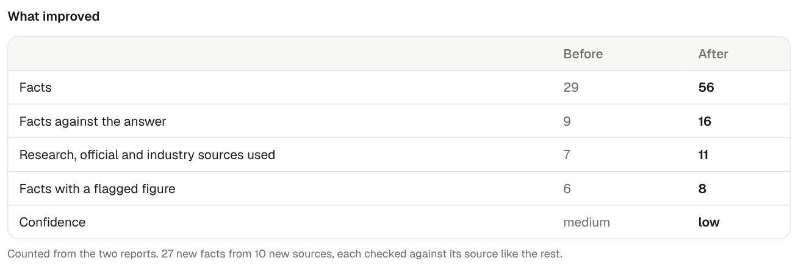
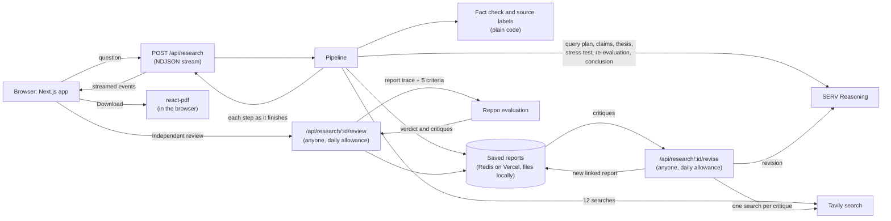

# Crux

**The Research Engine That Challenges Its Own Conclusions and Learns from Independent Criticism**

**Try it live: [crux.myacxt.site](https://crux.myacxt.site)**

Crux uses SERV Reasoning to investigate a difficult business question, build a thesis, and challenge its assumptions. Reppo then independently evaluates the reasoning and identifies weaknesses. Instead of merely displaying a score, Crux turns the feedback into targeted research, produces an auditable revision, and measures what actually improved.

**Crux becomes a research engine that can be independently challenged, correct its reasoning, and demonstrate what improved.**

Most AI research tools find support for an answer and write it up confidently. Even a tool that criticises itself is still marking its own homework. Crux adds an outside critic.

Built on [SERV Reasoning](https://docs.openserv.ai/serv-reasoning/why) (OpenServ) for every reasoning step, [Tavily](https://tavily.com) for web search, and [Reppo](https://www.reppofoundation.org/evaluation-api) for independent review.


## What's new: independent review by Reppo

The first version of Crux made research argue with itself: SERV forms a thesis, stress tests it like a skeptical investor, re-judges every assumption, and shows what changed. All of that criticism came from inside Crux, and the report ended at **What changed**.

Crux now sends the finished report to Reppo for **Independent review**, the step after What changed. An outside network judges the reasoning, and its critiques become the starting point for the next round of research.

**The home page**

| Before | Now |
| --- | --- |
|  |  |
| *AI research that stress tests its own conclusions.*<br>Using SERV Reasoning, Crux forms a thesis, stress tests it against the evidence and audits it. | *Research that ~~agrees~~ challenges itself.*<br>**SERV Reasoning** stress tests every answer. **Reppo** independently reviews it. |

**The steps of a report**

Before, the report ended at What changed:


Now, Independent review comes right after it, and has its own tab next to Evidence:


| | Before | Now |
| --- | --- | --- |
| Who criticises the answer | SERV, inside Crux | SERV inside Crux, then Reppo from outside |
| Last step | What changed | Independent review |
| What you get | A stress-tested answer | A stress-tested answer, an independent verdict and critiques, and an improved report that answers them |
| Reports | Kept by downloading the PDF | Saved for 90 days, so a review can be requested and checked later |

## How Crux works

Ask a hard business question. Crux runs seven steps, and the report fills in live as each one finishes:

| Step | Done by | What happens | Time |
| --- | --- | --- | --- |
| Research | SERV + Tavily | SERV plans 8 searches (half of them hunting for evidence against), Tavily runs them plus 4 repeats on research and official sites, 20 sources are picked, SERV extracts facts and Crux checks every quote against its source | about 30 s |
| Thesis | SERV | Commits to a first answer and names the assumptions it rests on | about 5 s |
| Stress test | SERV | Challenges the thesis like a skeptical investor: weak assumptions, contradicting evidence, other explanations, risks, missing evidence | about 7 s |
| Re-evaluate | SERV | Re-judges every assumption against the evidence and the challenges | about 9 s |
| Conclusion | SERV | The best-supported answer, its confidence, what's uncertain and what to check next | about 7 s |
| What changed | Crux | The first answer next to the final one, and why it moved, assembled from the recorded steps | instant |
| **Independent review** | **Reppo** | **The report goes to Reppo's evaluators, who judge the reasoning against five criteria and return a verdict and critiques** | **10 min or more** |
| **Improve with the feedback** | **SERV + Tavily** | **One focused search per critique, new facts checked against their sources, and a revised answer that responds to every critique, saved as a new report linked to the original** | **about a minute** |

The research takes about a minute (6 SERV calls and 12 Tavily searches). The review runs separately afterwards, so it never slows down the answer.

**To try it:** open [crux.myacxt.site](https://crux.myacxt.site), press **→** to fill in the demo question (*"Are small businesses actually willing to accept crypto payments?"*), and choose **Find the crux**. When the report is finished, click **Independent review**.

## Independent review

Crux's stress test is SERV checking SERV. Independent review gets a second opinion from outside: Reppo's evaluators judge the finished report against five criteria.

1. Do the cited quotes support the report's key claims, without unsupported leaps?
2. Does the stress test fairly address the strongest counter-evidence, risks and other explanations?
3. Does the conclusion follow from the evidence, the challenges and the re-evaluation?
4. Is the confidence calibrated to the evidence quality, the missing data and what's still uncertain?
5. Are the suggested validation steps specific and relevant?

How it works on a report:

1. Click **Independent review**, the step after What changed or the tab after Evidence, tick consent and choose **Request Reppo review**. Anyone can do this, no account or key needed.
2. Crux sends Reppo a compact trace of the report: the question, the thesis and its assumptions, the challenges, the re-evaluation, the conclusion, a balanced sample of facts with their quotes, and the source list.
3. After at least 10 minutes, **Check for verdict** fetches the result: accept, revise or reject, with a score, a confidence and a critique for each criterion. It's saved with the report, and the step turns green.

A verdict is independent feedback on the reasoning, not proof that every fact is correct.

Reppo's real verdict on the demo question: revise, 65 out of 100, with a written critique from each of three reviewers. All three said the same thing in different words: the report leaned on what businesses say they would do rather than what they actually do, and on figures that weren't verified.



### Learning from the critique

When the verdict is in, **Improve with this feedback** closes the loop:

1. Each critique becomes one focused web search, aimed at original data, that could resolve it.
2. Only sources the report doesn't already use are kept, and every new fact is checked against its source's own words, like the rest.
3. SERV revises the answer with the original and new evidence and the critiques in front of it. For every critique it says whether it is now addressed, partly addressed or not addressed, and why.
4. The improved report is saved as a new report, linked to the original, which stays exactly as it was. Its **After independent review** section shows the answer before and after, each critique and what was done about it, what changed, and a **What improved** table (facts, facts against, research and official sources, flagged figures, confidence) counted in code from the two reports, not estimated by the model.

The improved report can be sent for its own independent review, so the cycle can repeat.

On the demo question, Crux ran one focused search per reviewer, aimed at verified acceptance rates, actual adoption and the counter-evidence. It answered all three critiques. Instead of rewording the answer to please the reviewers, it narrowed the claim to conditional openness, separated stated willingness from actual adoption, and lowered its own confidence from medium to low:



The evidence behind it grew, and the counts come straight from the two reports:



Two of the extra flagged figures in this run were a small bug, since fixed: a fact that mentioned its source's label (S24) had the 24 counted as a figure. Follow-up searches now also leave out company sites and blogs whenever research, official, industry or news sources are found.

**Who can request a review, and what it costs.** Anyone can request a review and improve a report. Each review can use a Reppo credit and each improvement uses SERV and Tavily credits, so both have daily allowances: 3 per visitor and 20 for the whole site, resetting at midnight UTC (change them with the variables below). Visitors are counted by a salted hash of their IP address, never the address itself, and a failed attempt doesn't use up an allowance. Consent must be ticked every time, a report can only be reviewed and improved once, and reviews are off unless `REPPO_REVIEW_ENABLED=1`. Reppo's evaluators may see the submitted trace, so don't submit confidential research.

## Architecture



1. The browser posts the question; the API streams one event per step back as NDJSON, so the report fills in live.
2. The pipeline ([src/lib/pipeline.ts](src/lib/pipeline.ts)) runs the steps in order and records an audit entry for each: model, duration, inputs, output and warnings.
3. Research ([src/lib/research/collect.ts](src/lib/research/collect.ts)) plans the searches, runs them, picks sources query by query, and has SERV extract facts; the fact check and source labels are plain code.
4. The reasoning steps ([src/lib/reasoning/stages.ts](src/lib/reasoning/stages.ts)) cite records by ID. Unknown IDs are removed and logged before anything is saved.
5. Reports are saved ([src/lib/store.ts](src/lib/store.ts)) in Redis on Vercel for 90 days, or as files locally, and reopen at `/research/:id`.
6. Independent review ([src/app/api/research/[id]/review/route.ts](src/app/api/research/%5Bid%5D/review/route.ts)) builds the trace ([src/lib/reppo/payload.ts](src/lib/reppo/payload.ts)), submits it to Reppo, and saves the evaluation and, later, the verdict.
7. Improving ([src/lib/revise.ts](src/lib/revise.ts)) runs one focused search per critique through the same research and fact-check code, has SERV revise the answer, counts the before and after in code, and saves the result as a new report linked to the original.

## What the report shows

The screenshots below are from a live run of the demo question.

### Answer

The conclusion comes first, with its confidence and whether the stress test strengthened, weakened or overturned the first answer.


### What changed?

The first answer next to the answer after the stress test, and every material change with the reason and the evidence behind it. It's assembled from what the steps actually recorded, not generated after the fact.


### Stress test

Each challenge has a severity and a type, names the assumptions it targets, and links to its evidence.


### Assumptions, re-judged

Every assumption gets a verdict: supported, weakened, contradicted or unresolved, with the reasoning. One the re-evaluation skips is marked unresolved rather than passing silently.


### Evidence, fact-checked

Every fact shows the exact words it came from, with a link to the source. The summary says how many facts were dropped because their quote wasn't in the source, and sources are labelled by type. Evidence links elsewhere in the report open this view filtered to the facts behind one point.


### Audit trail

**Where it's used** on any fact shows the source and quote it rests on, and every place in the reasoning that relies on it.


### PDF report

**Download** saves the whole report as a PDF: the answer and what changed, Reppo's verdict and critiques, the reasoning, and the evidence with every quote and a numbered source list. An improved report's PDF also carries the before and after answers, the reply to each critique, what the review changed and the What improved table.


## Every step, in code

Each SERV step is a separate SERV Reasoning call (OpenAI-compatible chat completion) with a strict JSON schema, so its output is structured, recorded and auditable, never free text. Independent review is a separate call to Reppo's Evaluation API.

| Step | Service | Input | Output |
| --- | --- | --- | --- |
| Query plan | SERV | The question | 2 to 4 supporting and 3 to 4 challenging searches (the schema requires both), aimed at original data |
| Claims | SERV | The question and up to 20 source excerpts | Facts, each with the exact quote from its source, a category and a stance; plus each source's publisher type |
| Thesis | SERV | The checked facts | A first answer, its confidence and why, the assumptions it depends on, the facts behind it |
| Stress test | SERV | Facts and thesis | Challenges with type, severity, target assumptions and evidence; failure conditions; missing evidence |
| Re-evaluation | SERV | Facts, thesis, stress test | A verdict and reasoning for every assumption, the revised thesis, every change and what caused it |
| Conclusion | SERV | The whole record | Final answer, confidence, key supporting and challenging facts, uncertainties, next validation steps |
| Independent review | Reppo | A compact trace of the whole report (under 18 KB) and the five criteria | An evaluation ID, then a verdict (accept, revise or reject), score, confidence and per-criterion critiques |
| Revision plan | SERV | The question, the conclusion and the review's critiques | One focused search per critique |
| Revision | SERV | All the evidence (original and new), the original reasoning and conclusion, and the critiques | A response to every critique (addressed, partly or not, with the facts behind it), the revised conclusion, and every change from the original |

Each SERV call carries SERV's `serv_prompt_guard`, because the steps read untrusted web text. Model: `gpt-5.4-mini` through SERV by default (`SERV_MODEL` to change it).

## Honest by design

A research tool is only useful if you can trust what it shows, so these rules are enforced in code, with the prompts as a second layer.

| Rule | How it is enforced |
| --- | --- |
| An outside critic, not only self-criticism | Independent review sends the finished report to Reppo, so the reasoning is judged by evaluators outside Crux, not only by SERV's own stress test |
| A verdict is feedback, not proof | The review section says so, and Crux never presents a Reppo score as confirmation that the answer is true |
| Reviews are open, but protected | Anyone can request a review with consent, each report is reviewed and improved once, daily allowances cap spending, and API keys stay on the server |
| Every fact is backed by its source's own words | SERV must quote each source it cites. [verify.ts](src/lib/research/verify.ts) checks each quote against the source text. A fact with no quote found is dropped and counted in the summary |
| Figures must match | A figure a fact states must appear in one of its quotes, as digits or words ("thirty-three" matches 33). If not, the fact is flagged in the report and treated as unverified |
| The case against is always searched for | The search plan must include 3 to 4 challenging searches, and sources are picked search by search in turn, so the supporting searches can't crowd them out |
| A missing case against is called a gap, not proof | If no evidence against the answer survives, the later steps are told so, and the Evidence view says so |
| Original data comes first | Research, official and industry sources are searched for specifically and picked before news, and news before company sites and blogs |
| Weak sources count for less | Social posts and sources over three years old are flagged and marked as weak evidence |
| Citations can't dangle | Every ID a step cites is checked; unknown ones are removed and logged |
| No assumption is skipped | The re-evaluation must judge every assumption; any it leaves out is recorded as unresolved |
| What changed is not rewritten | It's assembled from the recorded thesis, stress test and re-evaluation |

Two limits to be plain about: a fact's **stance** (for or against) and the **type** of an unrecognised source are the model's judgement, and the fact check proves a quote is real, not that the fact's wording is a perfect paraphrase.

## What's next

Independent review and learning from it are built. Next:

1. **Review the improved report.** Send the improved demo report for its own independent review, and compare Reppo's two scores.
2. **User accounts and paid reviews,** so people can request more reviews than the free daily allowance.

Progress is tracked in [docs/S2_TASKS.md](docs/S2_TASKS.md).

## What was checked

- **The full loop, live.** On the demo question, Reppo returned revise, 65/100, with three critiques; Crux improved the report from them (27 new facts from 10 new sources, facts against 9 to 16, confidence medium to low) and saved it as a new report linked to the original. On the main site, the connection check reports Reppo and Redis connected.
- **Live research runs** with SERV and Tavily on the demo question: the case against is found (6 to 9 facts against per run), and research, official and industry sources make up most of the 20 sources.
- **Unit tests** (`npm test`, 113 tests): quote verification, figures in digits and words, source selection, balanced searches, the full pipeline end to end, the Reppo request, response parsing and owner-only access, and improving a report from its critiques (new facts numbered after the original's, sources not reused, every critique answered, the original left unchanged).
- **In a real browser** (headless Chromium): every view from 320 px phones to desktop, light and dark, PDF downloads, and the Independent review step from every view.
- **Type check, lint and production build** are clean, and GitHub Actions runs them on every pull request to `main`, without live API calls.

## Run it locally

You need [Node.js](https://nodejs.org) 22 or newer.

```bash
git clone https://github.com/Mhiah/crux.git
cd crux
npm install
cp .env.example .env.local   # then add your keys
npm run dev                  # open http://localhost:3000
```

| Variable | Purpose |
| --- | --- |
| `SERV_API_KEY` | SERV Reasoning |
| `TAVILY_API_KEY` | Web search |
| `REPPO_API_KEY` | Reppo, for Independent review (server-side only) |
| `REPPO_REVIEW_ENABLED` | `1` turns on review requests; off by default |
| `CRUX_REVIEW_ACCESS_TOKEN` | Optional private owner key (24+ random characters): needed for the `/reppo-connect` check, and skips the daily allowances |
| `CRUX_REVIEWS_PER_VISITOR`, `CRUX_REVIEWS_PER_DAY` | Daily review allowances per visitor and for the whole site (default 3 and 20) |
| `CRUX_IMPROVES_PER_VISITOR`, `CRUX_IMPROVES_PER_DAY` | Daily improvement allowances per visitor and for the whole site (default 3 and 20) |
| `CRUX_RUNS_PER_VISITOR`, `CRUX_RUNS_PER_DAY` | Daily live research-run allowances per visitor and for the whole site (default 10 and 100) |
| `KV_REST_API_URL` + `KV_REST_API_TOKEN` | Redis storage on Vercel (added by the Upstash integration), or `UPSTASH_REDIS_REST_URL` + `UPSTASH_REDIS_REST_TOKEN` |
| `SERV_MODEL` | Model to use through SERV (default `gpt-5.4-mini`) |
| `SERV_SHADOW_AGENT` | `1` adds SERV's shadow-agent check to each step (extra calls) |

Locally, reports are saved as files and reopen at `/research/:id`. Other commands:

```bash
npm run research -- "Should we launch an AI bookkeeping SaaS for Nigerian SMEs?"   # run from the terminal
npm run reppo:check # checks the Reppo key with a read-only call; never submits or spends credits
npm test
npm run typecheck
npm run lint
npm run build
```

## Deploy on Vercel

1. Import the GitHub repo in Vercel. The defaults (Next.js, `npm run build`) are right.
2. In **Settings → Environment Variables**, add `SERV_API_KEY` and `TAVILY_API_KEY` for Production.
3. For saved reports and Independent review: connect **Storage → Upstash Redis** to the project for Production (it adds the `KV_` variables), and add `REPPO_API_KEY`, `CRUX_REVIEW_ACCESS_TOKEN` and `REPPO_REVIEW_ENABLED=1`.
4. Redeploy (**Deployments → ⋯ → Redeploy**), because variables only apply to deployments made after they're added.
5. Check it at `/reppo-connect`: enter the owner key, and it confirms Reppo and Redis without submitting anything.

Without Redis, reports aren't saved and the Independent review step stays hidden. If SERV or Tavily credits run out, Crux shows the sample report instead, with a notice saying so.

## Project layout

```
src/
  app/
    page.tsx                  Home page and live results
    research/[id]/page.tsx    A saved report
    api/research/             POST a question (streams NDJSON), GET a saved run
    api/research/[id]/review/ Request a Reppo review, check for its verdict
    api/research/[id]/revise/ Improve a report from its review's critiques
    api/reppo/connection/     Owner-only Reppo and Redis connection check
    reppo-connect/page.tsx    The page for that check
  components/
    workstation.tsx           The steps row and the Answer, Reasoning and Evidence views
    reppo-review.tsx          The Independent review section
    report-pdf.tsx            The PDF report
    refs.tsx                  Audit-trail panel
  lib/
    pipeline.ts               Runs the steps and records the audit trail
    revise.ts                 Learning from the review: focused searches, revision, metrics
    reasoning/                SERV client, prompts, strict schemas, steps
    research/                 Search, source selection, fact check, source labels
    reppo/                    Reppo client, request builder, daily allowances, owner key, connection check
    store.ts                  Saved reports: Redis on Vercel, files locally
    plain.ts, trace.ts        Plain-language citations and the audit trail
    types.ts                  The data model
tests/                        Vitest unit tests
docs/screenshots/             The images in this README
docs/S2_TASKS.md              Task tracker
```

## Known limitations

- **Reviews have a daily allowance.** There are no user accounts yet, so allowances are counted per visitor (by a hash of their IP address) and for the whole site, and each review can use a Reppo credit.
- **One improvement per report.** Each report is improved once, from up to five critiques; to go further, review the improved report and improve that.
- **Evidence depth.** Each run reads up to 20 sources, and only the excerpt Tavily returns for each (up to 2,500 characters), not whole pages.
- **Judgement calls.** A fact's stance and the type of an unrecognised source come from the model.
- **SERV's prompt guard** occasionally blocks harmless requests. Blocks are retried up to twice; if a run still fails, running it again usually works.
