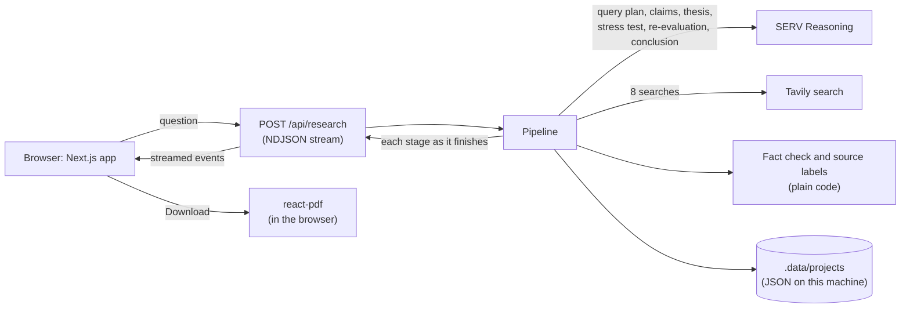

# Crux

**The Research Engine That Challenges Its Own Conclusions—and Learns from Independent Criticism**

Crux uses SERV Reasoning to investigate a difficult business question, build a thesis, and challenge its assumptions. Reppo then independently evaluates the reasoning and identifies weaknesses. Instead of merely displaying a score, Crux turns the feedback into targeted research, produces an auditable revision, and measures what actually improved.

**Crux becomes a research engine that can be independently challenged, correct its reasoning, and demonstrate what improved.**

**Try it live: [crux-rose-nu.vercel.app](https://crux-rose-nu.vercel.app)** (research, stress test, verified evidence, PDF brief, and Independent review)

> **Season 2 status:** independent review through Reppo is live on the main site as an owner-only pilot: saved reports show the **Independent review** link, and only the owner key can request a review. The first evaluation was accepted by Reppo and is awaiting its verdict. Feedback-driven correction and measured improvement are next. See [Season 2](#season-2-independently-challenged-research) for exactly what works today and what is planned.

Crux is a research engine for hard market, business and strategy questions. Using SERV Reasoning, it forms a thesis, stress tests it against the evidence and audits it. Instead of searching for support and writing a confident report, it commits to a first answer, looks hard for what would make that answer wrong, re-judges it, and shows you exactly what changed and why. Every fact it uses is matched to the exact words in its source.

Built on [SERV Reasoning](https://docs.openserv.ai/serv-reasoning/why) (OpenServ) for every reasoning step and [Tavily](https://tavily.com) for web search.


## Try it in a few minutes

Every number below is from a real run of the demo question on 26 September 2026, with live SERV and Tavily calls.

1. Open **[crux-rose-nu.vercel.app](https://crux-rose-nu.vercel.app)**.
2. The demo question, **"Are small businesses actually willing to accept crypto payments?"**, is shown faintly in the box. Press **→** (or Tab) to fill it in, or tap the box on a phone.
3. Choose **Find the crux**. The report fills in stage by stage as each one finishes:

   

   | Stage | What happens | Time |
   | --- | --- | --- |
   | Research | SERV plans 8 searches (half of them hunting for evidence against), Tavily runs them plus 4 repeats on research and official sites, 20 sources are picked, SERV extracts facts and Crux checks every quote | 30.1 s |
   | Thesis | SERV commits to a first answer and names the assumptions it rests on | 4.6 s |
   | Stress test | SERV challenges the thesis: weak assumptions, contradicting evidence, other explanations, risks, missing evidence | 6.8 s |
   | Re-evaluate | Every assumption is re-judged against the evidence and the challenges | 9.2 s |
   | Conclusion | The best-supported answer, its confidence, what's uncertain and what to check next | 6.9 s |
   | What changed | Assembled from the recorded stages, no model call | 0 s |

   About a minute in total, 6 SERV calls and 12 Tavily searches.
4. Read the **Answer**, then open **Reasoning** and **Evidence**. Anything backed by facts has an **Evidence** link that opens just those facts.
5. Choose **Download** for the report as a PDF.

## The problem

Most AI research tools search for evidence that supports an answer and then write it up confidently. They rarely look for the case against, the sources behind the claims are hard to check, and you can't see whether the reasoning ever changed its mind. For a decision like launching a product or entering a market, that confidence is the risk.

## What Crux does

### Answer

The conclusion comes first, with its confidence and whether the stress test strengthened, weakened or overturned the first answer. From the demo run:


### What changed?

The first answer next to the answer after the stress test, and every material change with the reason and the evidence behind it. This view is assembled from what the stages actually recorded; it isn't generated after the fact.


In the demo run, the thesis was **weakened**: four changes, each backed by specific facts and challenges, turned "willing in principle, but acceptance lags" into "only a cautious, conditional yes: acceptance is low, and much of the evidence is about merchants in general rather than small businesses".

### Stress test

SERV acts as a skeptical investor and challenges the first answer. Each challenge has a severity and a type, names the assumptions it targets, and links to its evidence. The demo run raised 6 challenges, 1 of them critical.


### Assumptions, re-judged

Every assumption the thesis depends on gets a verdict: supported, weakened, contradicted or unresolved, with the reasoning. If the re-evaluation skips one, Crux marks it unresolved rather than letting it pass silently. In the demo run: 3 weakened, 2 supported.


### Evidence, fact-checked

Every fact shows the exact words it came from, with a link to the source. The summary at the top says how many extracted facts were dropped because their quote wasn't in the source, and sources are labelled by type. The demo run kept 28 of the 31 facts it extracted (15 for, 7 against, 6 neutral) from 20 sources: 5 research, 1 official, 6 industry reports, 7 news and 1 company site. It flagged 1 fact whose sample size wasn't in its quote.


Evidence links elsewhere in the report open this view filtered to the facts behind one point:


### Audit trail

**Where it's used** on any fact opens its trail in both directions: the source and quote it rests on, and every place in the reasoning that relies on it (the thesis, assumptions, challenges, re-evaluation, conclusion).


### PDF report

**Download** saves the whole report as a PDF straight to your device, built in the browser: the answer and what changed, then the reasoning, then the evidence as an appendix with every quote and a numbered source list.


### Light and dark, desktop and phone

The toggle at the top right switches light and dark (it follows the device until you use it, with no flash on load). Every view works from 320 px phones up.


## How SERV does the reasoning

Every reasoning step is a separate SERV Reasoning call (OpenAI-compatible chat completion) with a strict JSON schema, so each stage's output is structured, recorded and auditable, never free text.

| Call | Input | Output |
| --- | --- | --- |
| Query plan | The question | 2 to 4 supporting and 3 to 4 challenging searches (the schema requires both), aimed at original data |
| Claims | The question and up to 20 source excerpts | Facts, each with the exact quote from its source, a category and a stance; plus each source's publisher type |
| Thesis | The checked facts | A first answer, its confidence and why, the assumptions it depends on, the facts behind it |
| Stress test | Facts and thesis | Challenges with type, severity, target assumptions and evidence; failure conditions; missing evidence |
| Re-evaluation | Facts, thesis, stress test | A verdict and reasoning for every assumption, the revised thesis, every change and what caused it |
| Conclusion | The whole record | Final answer, confidence, key supporting and challenging facts, uncertainties, next validation steps |

Each call also carries SERV's `serv_prompt_guard`, because the stages read untrusted web text. Model: `gpt-5.4-mini` through SERV by default (`SERV_MODEL` to change it). `SERV_SHADOW_AGENT=1` adds SERV's shadow-agent check to every stage.

## Architecture



1. The browser posts the question; the API streams one event per stage back as NDJSON, so the report fills in live.
2. The pipeline ([src/lib/pipeline.ts](src/lib/pipeline.ts)) runs the stages in order and records an audit entry for each: model, duration, inputs, output and warnings.
3. Research ([src/lib/research/collect.ts](src/lib/research/collect.ts)) plans the searches, runs them, picks sources query by query, and has SERV extract facts; the fact check and source labels are plain code.
4. The reasoning stages ([src/lib/reasoning/stages.ts](src/lib/reasoning/stages.ts)) cite records by ID. Unknown IDs are removed and logged before anything is saved.
5. Runs are saved as JSON on the machine running the app and reopen at `/research/:id`. Nothing is sent anywhere else. On Vercel, runs aren't saved; the report is kept by downloading the PDF.

## Honest by design

A research tool is only useful if you can trust what it shows, so the rules below are enforced in code, with the prompts as a second layer.

| Rule | How it is enforced |
| --- | --- |
| Every fact is backed by its source's own words | SERV must quote each source it cites. [verify.ts](src/lib/research/verify.ts) checks each quote against the source text (ignoring case, spacing, curly quotes and dashes; `...` may skip words, in order). A source whose quote isn't found stops backing the fact; a fact with no quote found is dropped and counted in the summary |
| Figures must match | A figure a fact states (in digits) must appear in one of its quotes, as digits or words ("thirty-three" matches 33). If not, the fact is kept, flagged in the report, and passed to the later stages as unverified |
| The case against is always searched for | The query-plan schema requires 3 to 4 challenging searches. They run interleaved with the supporting ones, and sources are picked search by search in turn, so a supporting search's higher relevance scores can't crowd them out |
| A missing case against is called a gap, not proof | If no evidence against the answer survives, the later stages are told so explicitly, and the Evidence view says so |
| Original data comes first | The search plan aims at surveys, studies, official statistics and research firms. The first 4 searches run again limited to about 120 research, official and industry-report sites. Within each search, those sources are picked before news, and news before company sites and blogs |
| Weak sources count for less | Social posts and sources over three years old are flagged, only fill source slots the others leave open, and facts resting only on them are marked as weak evidence for the later stages and in the report |
| Citations can't dangle | Every ID a stage cites is checked against the records that exist. Unknown ones are removed and logged, so every audit-trail link leads somewhere |
| No assumption is skipped | The re-evaluation must judge every assumption; any it leaves out is recorded as unresolved |
| What changed is not rewritten | It's assembled from the recorded thesis, stress test and re-evaluation, not generated separately |
| Web text is untrusted | Excerpts are labelled as untrusted in every prompt and every call carries SERV's prompt guard |

Two limits to be plain about: a fact's **stance** (for or against) and the **type** of an unrecognised source are the model's judgement, and the fact check proves the quote is real, not that the fact's wording is a perfect paraphrase beyond its figures.

## What was checked

- **Live runs with SERV and Tavily.** Five live runs of the crypto question on 26 September 2026. The balanced-research change took the evidence from 24 for and 0 against to a real case against (6 to 9 facts against in each later run). The stronger-sources change took the source mix from 13 company or blog sites out of 20 to 1, with research, official statistics and industry reports making up 12.
- **The screenshots** are from the fifth run, shown exactly as it came back. 3 of the 31 extracted facts were dropped because their quotes weren't in the source text (one rested on a Statista page whose figures sit behind a paywall), and 1 is flagged because it states a sample size its quote doesn't contain.
- **Unit tests** (`npm test`, 89 tests): quote verification, figures in digits and words, source labels and selection (stronger sources first), balanced queries, ID and dash stripping (only this run's IDs, ranges and abbreviations handled), prompt-guard retries, the switch to sample data when credits run out, the full pipeline end to end, and (Season 2) the Reppo request shape, response parsing and owner-only access.
- **The UI in a real browser** (headless Chromium): every view at 320, 360, 390 and 1200 px, light and dark, no sideways scrolling, PDF downloads, the demo question by arrow key and by tap.
- **Type check, lint and production build** are clean (`npm run typecheck`, `npm run lint`, `npm run build`), and GitHub Actions runs all four on every push to the Season 2 branch and every pull request to `main`, without live API calls.

## Run it locally

You need [Node.js](https://nodejs.org) 22 or newer.

```bash
git clone https://github.com/Mhiah/crux.git
cd crux
npm install
cp .env.example .env.local   # then add SERV_API_KEY and TAVILY_API_KEY
npm run dev                  # open http://localhost:3000
```

Each question uses about 6 SERV calls and 12 Tavily searches and takes around a minute.

**On a phone:** keep the app running, connect the phone to the same Wi-Fi, and open the **Network** address that `npm run dev` prints (for example `http://192.168.0.3:3000`).

| Variable | Purpose |
| --- | --- |
| `SERV_API_KEY` | SERV Reasoning |
| `TAVILY_API_KEY` | Web search |
| `SERV_MODEL` | Model to use through SERV (default `gpt-5.4-mini`) |
| `SERV_SHADOW_AGENT` | `1` adds SERV's shadow-agent check to each stage (extra calls) |
| `REPPO_API_KEY` | Season 2: Reppo Evaluation API key (server-side only) |
| `REPPO_REVIEW_ENABLED` | Season 2: `1` turns on paid review requests; off by default |
| `CRUX_REVIEW_ACCESS_TOKEN` | Season 2: private owner key (24+ random characters) required to request or check a review |
| `KV_REST_API_URL` + `KV_REST_API_TOKEN` | Season 2: Redis storage from Vercel's Upstash integration (or `UPSTASH_REDIS_REST_URL` + `UPSTASH_REDIS_REST_TOKEN`) so reports are saved and can be reviewed |

Other commands:

```bash
npm run research -- "Should we launch an AI bookkeeping SaaS for Nigerian SMEs?"   # run from the terminal
npm test            # unit tests
npm run typecheck
npm run lint
npm run build
npm run reppo:check # Season 2: checks the Reppo key with a read-only call; never submits or spends credits
```

## Deploy on Vercel

1. Import the GitHub repo in Vercel. The defaults (Next.js, `npm run build`) are right.
2. In **Settings → Environment Variables**, add `SERV_API_KEY` and `TAVILY_API_KEY` for Production (and Preview if you use it). Your `.env.local` file is never uploaded, so without this step the app has no keys and shows the sample report.
3. Redeploy (**Deployments → ⋯ → Redeploy**), because variables only apply to deployments made after they're added.

A run takes about a minute, and the research API allows up to 300 seconds. On Vercel, runs aren't saved (functions can't keep files), so there is no "Saved report" link; use **Download** to keep a report.

To enable Season 2 reviews on a deployment, also add the Redis variables (Vercel **Storage → Upstash Redis** adds them for you), `REPPO_API_KEY`, `CRUX_REVIEW_ACCESS_TOKEN` and `REPPO_REVIEW_ENABLED=1`, then redeploy. With Redis connected, runs are saved for 90 days and the "Saved report" link returns. Without these, the review section stays hidden.

If SERV or Tavily credits run out, Crux doesn't fail: it shows the sample report instead, with a notice that the credits have run out and that the report isn't research on your question.

## Project layout

```
src/
  app/
    page.tsx                  Home page and live results
    research/[id]/page.tsx    A saved report
    api/research/             POST a question (streams NDJSON), GET a saved run
    api/research/[id]/review/ Season 2: request a Reppo review, check for its verdict
    api/reppo/connection/     Season 2: owner-only Reppo and Redis connection check (no charge)
    reppo-connect/page.tsx    Season 2: page for that connection check
    icon.svg                  Tab icon
  components/
    workstation.tsx           Answer, Reasoning and Evidence views
    report-pdf.tsx            The PDF report
    refs.tsx                  Audit-trail panel
    reppo-review.tsx          Season 2: the Independent review panel
    brand.tsx                 The CRUX wordmark
    site-header.tsx, theme-toggle.tsx, home-button.tsx
  lib/
    pipeline.ts               Runs the stages and records the audit trail
    reasoning/                SERV client, prompts, strict schemas, stages
    research/                 Search, source selection, fact check, source labels
    plain.ts                  Turns cited IDs into plain sentences and Evidence links
    trace.ts                  Resolves any record to what it rests on and what uses it
    reppo/                    Season 2: Reppo client, request builder, owner access, connection check
    store.ts                  Saved runs: local files, or Redis on Vercel
    mock/                     Sample data for the tests
    types.ts                  The data model
tests/                        Vitest unit tests
docs/screenshots/             The images in this README
docs/S2_TASKS.md              Season 2 task tracker
```

## Season 2: independently challenged research

### Positioning

**Crux: The Research Engine That Challenges Its Own Conclusions—and Learns from Independent Criticism**

Crux uses SERV Reasoning to investigate a difficult business question, build a thesis, and challenge its assumptions. Reppo then independently evaluates the reasoning and identifies weaknesses. Instead of merely displaying a score, Crux turns the feedback into targeted research, produces an auditable revision, and measures what actually improved.

Crux becomes a research engine that can be **independently challenged, correct its reasoning, and demonstrate what improved**.

Season 1 made Crux argue with itself. Season 2 adds a critic from outside: the stress test is still SERV checking its own work, and Reppo's evaluators are an independent second opinion that Crux can learn from.

### Before and after Reppo

**1. The home page: the new tagline**

| Before: Season 1 | After: Season 2 |
| --- | --- |
|  |  |
| *AI research that stress tests its own conclusions.*<br>Using SERV Reasoning, Crux forms a thesis, stress tests it against the evidence and audits it. | *Research that challenges itself.*<br>SERV Reasoning stress tests every answer. Reppo independently reviews it. |

**2. The progress row: Independent review after What changed**

| Before: Season 1 ends at What changed |
| --- |
|  |

| After: Season 2 adds Independent review |
| --- |
|  |

In Season 1 all the criticism comes from inside Crux and the run ends at **What changed**. In Season 2, **Independent review** comes right after it: click it to open the review section, where the report can be sent to Reppo and its verdict and critiques appear. The link shows on finished live reports that are saved, so a review can be requested and checked later.

### How it works

1. **Research.** SERV plans balanced searches (half look for evidence against the answer), Tavily runs them, and Crux checks every quote against its source.
2. **Thesis and stress test.** SERV commits to a first answer, then challenges it: weak assumptions, contradicting evidence, other explanations, risks and missing evidence.
3. **Re-evaluate and conclude.** Every assumption gets a verdict, and **What changed** shows how the answer moved. The six Season 1 stages are unchanged.
4. **Independent review (built).** After **What changed**, the **Independent review** link opens the review section. The owner enters the private review key, ticks consent, and Crux sends Reppo a compact, source-linked trace of the report with five criteria:
   - Do the cited quotes support the key claims?
   - Does the stress test fairly address the strongest counter-evidence?
   - Does the conclusion follow from the evidence, challenges and re-evaluation?
   - Is the confidence calibrated to the evidence and what's missing?
   - Are the validation steps specific and relevant?

   Reppo's network evaluates it (at least 10 minutes), and **Check for verdict** fetches the decision (accept, revise or reject), score, confidence and per-criterion critiques, which are saved with the report. A verdict is external feedback, **not** proof that every fact is correct.
5. **Targeted correction (planned).** Turn each settled critique into a focused research question and revisit only the claims, assumptions or reasoning it affects, adding new evidence where needed, instead of rerunning the whole report.
6. **Auditable revision (planned).** Keep the original report and the Reppo feedback unchanged, create a linked revision, and show exactly what changed and why, the same way **What changed** does today.
7. **Measured improvement (planned).** Compare the versions: evidence coverage, unsupported claims, critiques addressed, confidence justification and the external assessment. A higher score is not treated as proof the answer is true.

Season 2 builds on SERV Reasoning V2 (no V3 Graph Sharding), and keeps the Crux dashboard, evidence views, audit trail and PDF report as they are.

### What works today

| Capability | Status |
| --- | --- |
| Season 1: research, stress test, re-evaluation, verified evidence, audit trail, PDF | Live |
| Reppo request with five criteria, a bounded trace (under 18 KB) and a no-charge size check | Built; first evaluation accepted by Reppo |
| Owner-only review key, explicit consent, server-side keys, one request at a time per report | Built (pilot control, not user accounts) |
| Saved reports in Redis (90 days) so a review can be requested and checked later | Live |
| **Independent review** link after **What changed**, on live results and saved reports | Built |
| Settled verdict retrieved and saved | Waiting for Reppo's verdict on the first evaluation |
| Critique-driven correction, linked revisions, before/after metrics | Planned |
| User accounts, quotas and cost limits for public reviews | Planned |

### Data, consent and cost

- Reppo receives a compact text trace of the report (question, thesis, challenges, re-evaluation, conclusion, a balanced sample of facts with their quotes, and the source list), not the whole saved project. Reppo's evaluators may see it, so don't submit confidential research.
- Each evaluation can use a Reppo credit. Reviews are off unless `REPPO_REVIEW_ENABLED=1`, need the private owner key, and need consent ticked every time. **Check request (no charge)** shows the request size and criteria without contacting Reppo, and `/reppo-connect` checks the Reppo key and Redis without submitting anything.
- Visitors can see the Independent review section on saved reports, but only the owner key can request a review or check a verdict, so visitors can never spend credits.

### Architecture

Next.js UI → NDJSON pipeline → SERV Reasoning stages + Tavily evidence → saved `ResearchProject` (Redis) → opt-in Reppo Evaluation API → saved evaluation ID, pending or settled verdict → (planned) targeted correction and versioned comparison. The review runs separately from the research, so it never slows down or blocks the original answer.

Season 2 is merged into `main` and runs on the main site; further Season 2 work continues on `feat/s2-reppo-review` with a Vercel Preview. Milestones are tracked in [docs/S2_TASKS.md](docs/S2_TASKS.md), and the Reppo API is documented at [reppofoundation.org/evaluation-api](https://www.reppofoundation.org/evaluation-api).

## Known limitations

- **Evidence depth.** Each run reads up to 20 sources, and only the excerpt Tavily returns for each (up to 2,500 characters), not whole pages.
- **Judgement calls.** A fact's stance and the type of an unrecognised source come from the model. Recognised sites are labelled by address.
- **What the fact check proves.** That each quote really appears in its source, and that the fact's figures appear in it. It doesn't prove the fact's wording is a faithful summary beyond that. Spelled-out numbers are read up to ninety-nine.
- **SERV's prompt guard** occasionally blocks harmless requests. Blocks are retried up to twice; if a run still fails, running it again usually works.
- **One model.** Runs use `gpt-5.4-mini` through SERV unless `SERV_MODEL` is set; other models haven't been tested.
- **Saved reports.** Locally they are files; on Vercel they need the Redis integration (90 days), otherwise use the PDF. There are no user accounts yet; Season 2 reviews use a single owner key.
- **The PDF has no page numbers.**
- **Independent review is a pilot.** Only the owner can request reviews, and turning critiques into corrections is still being built.
