# Crux

**The Research Engine That Challenges Its Own Conclusions and Learns from Independent Criticism**

**Try it live: [crux-rose-nu.vercel.app](https://crux-rose-nu.vercel.app)**

Crux uses SERV Reasoning to investigate a difficult business question, build a thesis, and challenge its assumptions. Reppo then independently evaluates the reasoning and identifies weaknesses. Instead of merely displaying a score, Crux turns the feedback into targeted research, produces an auditable revision, and measures what actually improved.

**Crux becomes a research engine that can be independently challenged, correct its reasoning, and demonstrate what improved.**

Built on [SERV Reasoning](https://docs.openserv.ai/serv-reasoning/why) (OpenServ) for every reasoning step, [Tavily](https://tavily.com) for web search, and [Reppo](https://www.reppofoundation.org/evaluation-api) for independent review.

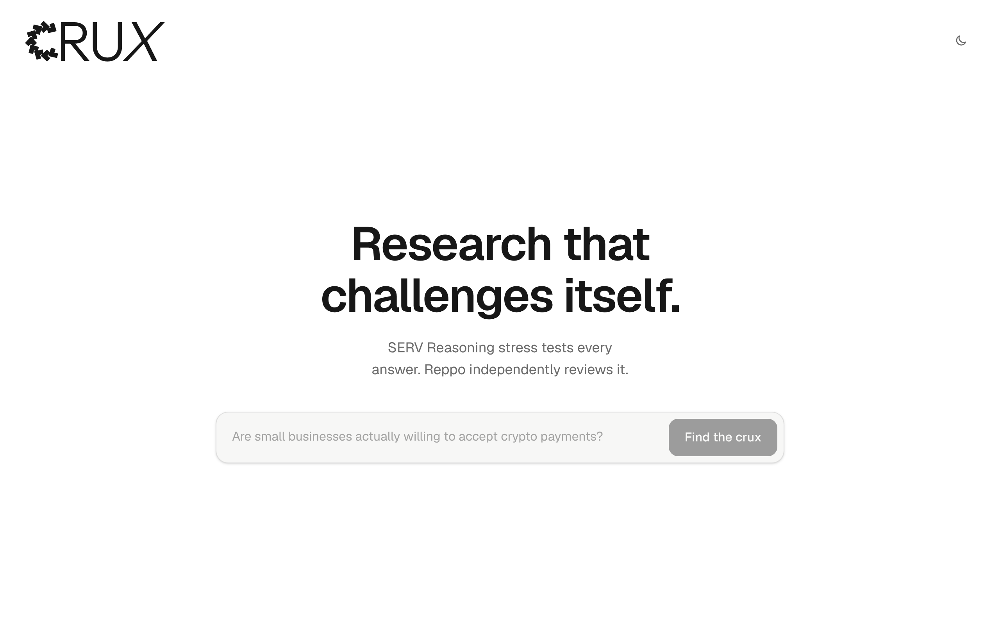

## Try it in a few minutes

1. Open **[crux-rose-nu.vercel.app](https://crux-rose-nu.vercel.app)**.
2. The demo question, **"Are small businesses actually willing to accept crypto payments?"**, is shown faintly in the box. Press **→** (or Tab) to fill it in, or tap the box on a phone.
3. Choose **Find the crux**. The report fills in stage by stage as each one finishes:

   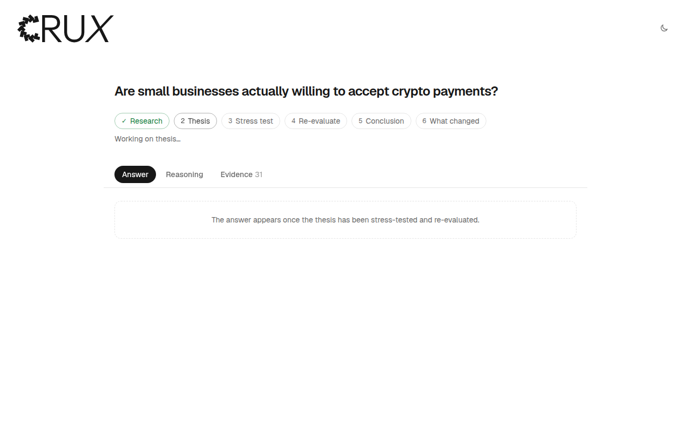

   | Stage | What happens | Time |
   | --- | --- | --- |
   | Research | SERV plans 8 searches (half of them hunting for evidence against), Tavily runs them plus 4 repeats on research and official sites, 20 sources are picked, SERV extracts facts and Crux checks every quote | 30.1 s |
   | Thesis | SERV commits to a first answer and names the assumptions it rests on | 4.6 s |
   | Stress test | SERV challenges the thesis: weak assumptions, contradicting evidence, other explanations, risks, missing evidence | 6.8 s |
   | Re-evaluate | Every assumption is re-judged against the evidence and the challenges | 9.2 s |
   | Conclusion | The best-supported answer, its confidence, what's uncertain and what to check next | 6.9 s |
   | What changed | Assembled from the recorded stages, no model call | 0 s |

   About a minute in total, 6 SERV calls and 12 Tavily searches. The report is saved, so it can be reopened and reviewed later.
4. Read the **Answer**, then open **Reasoning** and **Evidence**. Anything backed by facts has an **Evidence** link that opens just those facts.
5. Open **Independent review**, the fourth tab (or the link after **What changed**), to send the report to Reppo and read its verdict.
6. Choose **Download** for the report as a PDF.

## The problem

Most AI research tools search for evidence that supports an answer and then write it up confidently. They rarely look for the case against, the sources behind the claims are hard to check, and you can't see whether the reasoning ever changed its mind. Even a tool that criticises itself is still marking its own homework. For a decision like launching a product or entering a market, that confidence is the risk.

## What Crux does

The report screenshots below are from a live run of the demo question on 26 September 2026.

### Answer

The conclusion comes first, with its confidence and whether the stress test strengthened, weakened or overturned the first answer.

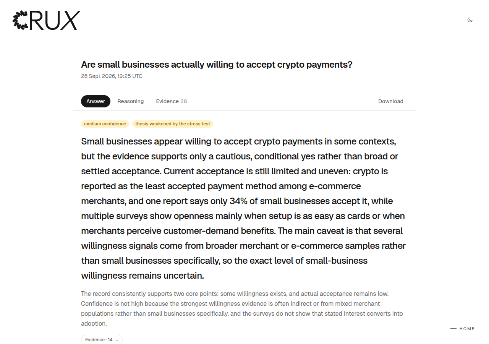

### What changed?

The first answer next to the answer after the stress test, and every material change with the reason and the evidence behind it. This view is assembled from what the stages actually recorded; it isn't generated after the fact.

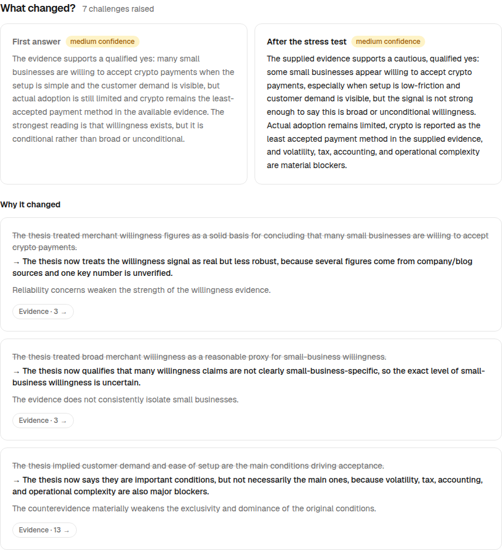

In the demo run, the thesis was **weakened**: four changes, each backed by specific facts and challenges, turned "willing in principle, but acceptance lags" into "only a cautious, conditional yes: acceptance is low, and much of the evidence is about merchants in general rather than small businesses".

### Stress test

SERV acts as a skeptical investor and challenges the first answer. Each challenge has a severity and a type, names the assumptions it targets, and links to its evidence. The demo run raised 6 challenges, 1 of them critical.

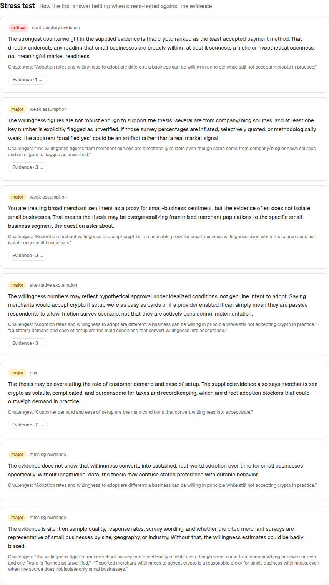

### Assumptions, re-judged

Every assumption the thesis depends on gets a verdict: supported, weakened, contradicted or unresolved, with the reasoning. If the re-evaluation skips one, Crux marks it unresolved rather than letting it pass silently. In the demo run: 3 weakened, 2 supported.

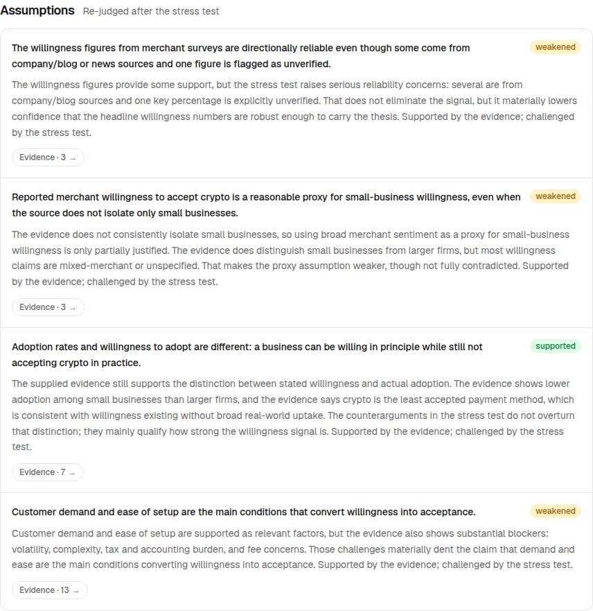

### Evidence, fact-checked

Every fact shows the exact words it came from, with a link to the source. The summary at the top says how many extracted facts were dropped because their quote wasn't in the source, and sources are labelled by type. The demo run kept 28 of the 31 facts it extracted (15 for, 7 against, 6 neutral) from 20 sources: 5 research, 1 official, 6 industry reports, 7 news and 1 company site.

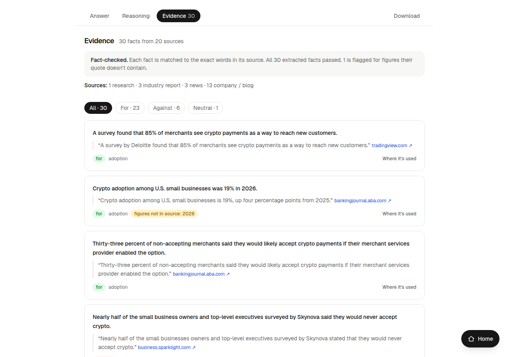

Evidence links elsewhere in the report open this view filtered to the facts behind one point:

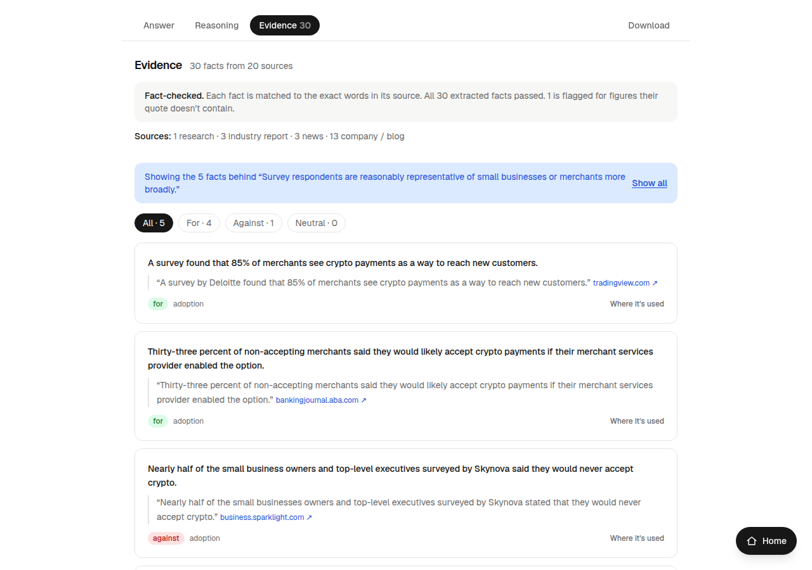

### Audit trail

**Where it's used** on any fact opens its trail in both directions: the source and quote it rests on, and every place in the reasoning that relies on it (the thesis, assumptions, challenges, re-evaluation, conclusion).

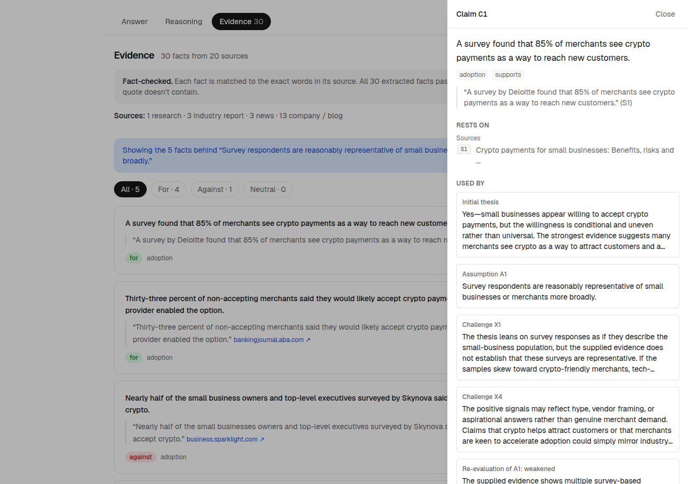

### Independent review

Crux's own stress test is SERV checking SERV. The **Independent review** tab sends the finished report to Reppo, whose evaluators judge the reasoning from outside, against five criteria:

1. Do the cited quotes support the report's key claims, without unsupported leaps?
2. Does the stress test fairly address the strongest counter-evidence, risks and other explanations?
3. Does the conclusion follow from the evidence, the challenges and the re-evaluation?
4. Is the confidence calibrated to the evidence quality, the missing data and what's still uncertain?
5. Are the suggested validation steps specific and relevant?

How it works on a report:

1. Open **Independent review**, enter the owner key, tick consent and choose **Request Reppo review**.
2. Crux sends Reppo a compact trace of the report: the question, the thesis and its assumptions, the challenges, the re-evaluation, the conclusion, a balanced sample of facts with their quotes, and the source list.
3. Reppo's evaluation takes at least 10 minutes. **Check for verdict** fetches it: accept, revise or reject, with a score, a confidence and a critique for each criterion. It's saved with the report.

A verdict is independent feedback on the reasoning, not proof that every fact is correct.

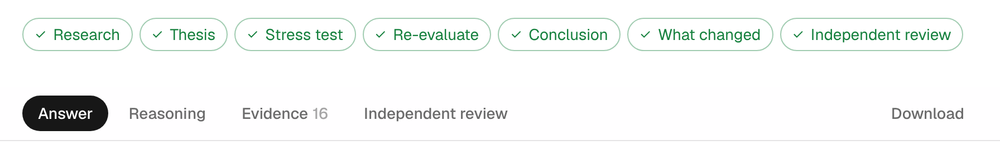

### PDF report

**Download** saves the whole report as a PDF straight to your device, built in the browser: the answer and what changed, then the reasoning, then the evidence as an appendix with every quote and a numbered source list.

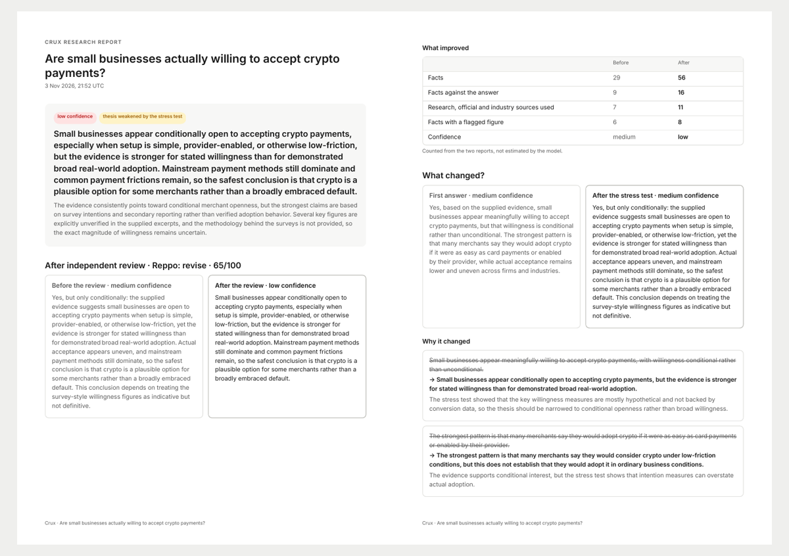

### Light and dark, desktop and phone

The toggle at the top right switches light and dark (it follows the device until you use it, with no flash on load). Every view works from 320 px phones up.

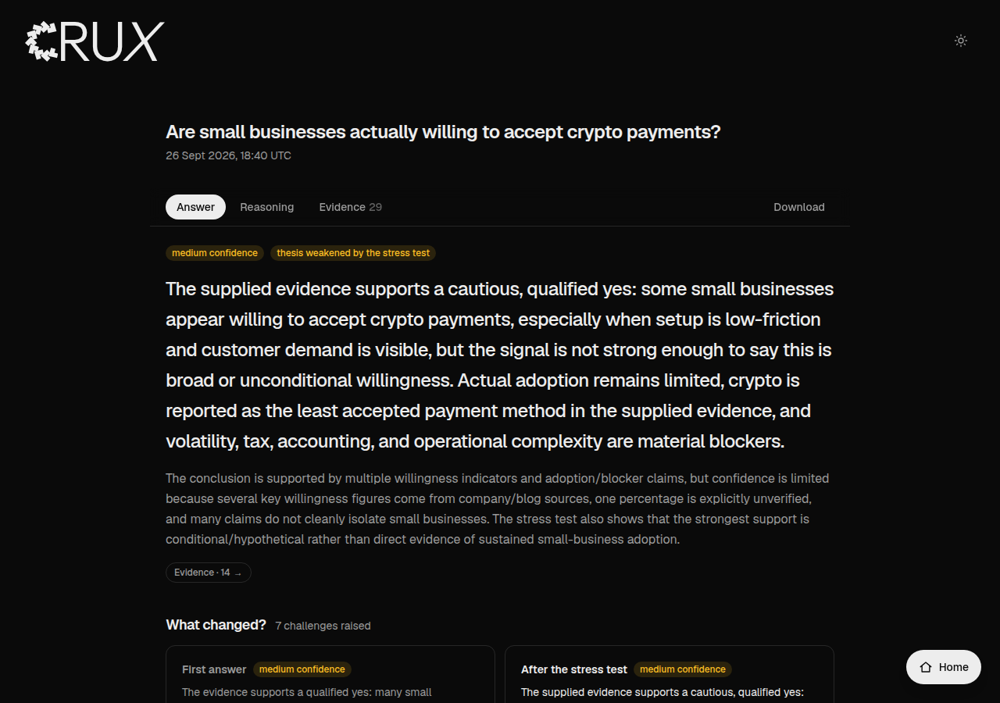

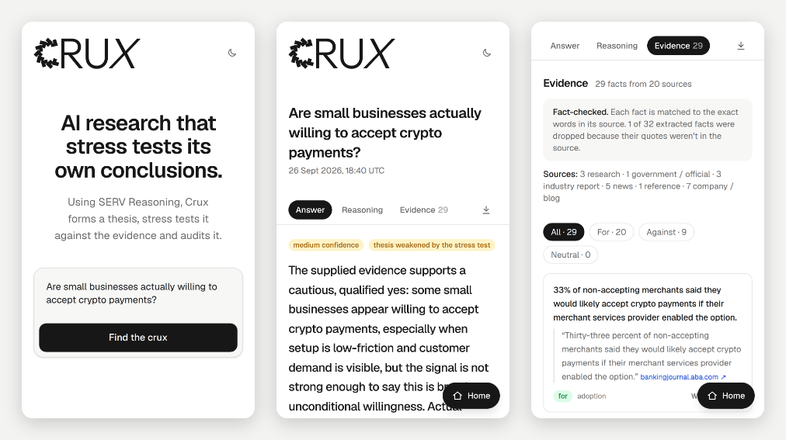

## From the first Crux to Crux with Reppo

The first Crux (Season 1) made research argue with itself: SERV forms a thesis, stress tests it as a skeptical investor, re-judges every assumption, and shows what changed. All of that criticism came from inside Crux, and the report ended at **What changed**.

Now that Crux is integrated with Reppo (Season 2), the report doesn't stop there. **Independent review** comes straight after What changed: an outside network judges the reasoning, and its critiques become the starting point for the next round of research.

**1. The home page**

| The first Crux | Crux with Reppo |
| --- | --- |
| 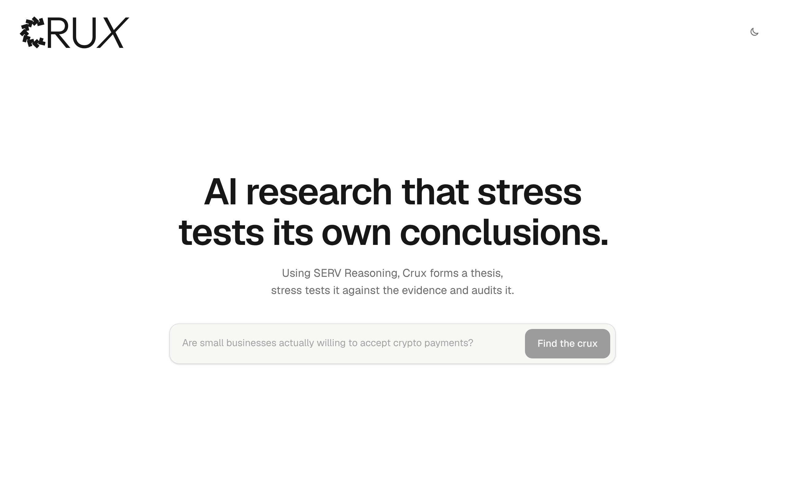 |  |
| *AI research that stress tests its own conclusions.*<br>Using SERV Reasoning, Crux forms a thesis, stress tests it against the evidence and audits it. | *Research that challenges itself.*<br>SERV Reasoning stress tests every answer. Reppo independently reviews it. |

**2. The top of a report**

The first Crux ends at **What changed**, with three tabs:

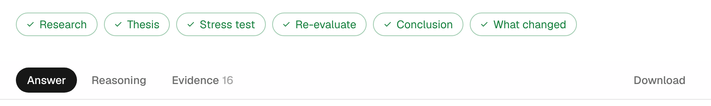

Crux with Reppo adds **Independent review** after What changed, and as a fourth tab:


| | The first Crux | Crux with Reppo |
| --- | --- | --- |
| Who criticises the answer | SERV, inside Crux | SERV inside Crux, then Reppo from outside |
| Where the report ends | What changed | Independent review |
| What you get | A stress-tested answer | A stress-tested answer plus an independent verdict and critiques |
| Reports | Kept by downloading the PDF | Saved for 90 days, so a review can be requested and checked later |

## What's next: learning from the criticism

The review is live. The next step closes the loop described at the top:

1. **Targeted research.** Turn each Reppo critique into a focused research question, and revisit only the claims, assumptions or reasoning it affects, adding new evidence where needed, instead of rerunning the whole report.
2. **Auditable revision.** Keep the original report and Reppo's feedback unchanged, create a linked revision, and show exactly what changed and why, the same way **What changed** does today.
3. **Measured improvement.** Compare the versions: evidence coverage, unsupported claims, critiques addressed, confidence justification and Reppo's assessment. A higher score is never treated as proof the answer is true.

Progress is tracked in [docs/S2_TASKS.md](docs/S2_TASKS.md).

## How SERV does the reasoning

Every reasoning step is a separate SERV Reasoning call (OpenAI-compatible chat completion) with a strict JSON schema, so each stage's output is structured, recorded and auditable, never free text.

| Call | Input | Output |
| --- | --- | --- |
| Query plan | The question | 2 to 4 supporting and 3 to 4 challenging searches (the schema requires both), aimed at original data |
| Claims | The question and up to 20 source excerpts | Facts, each with the exact quote from its source, a category and a stance; plus each source's publisher type |
| Thesis | The checked facts | A first answer, its confidence and why, the assumptions it depends on, the facts behind it |
| Stress test | Facts and thesis | Challenges with type, severity, target assumptions and evidence; failure conditions; missing evidence |
| Re-evaluation | Facts, thesis, stress test | A verdict and reasoning for every assumption, the revised thesis, every change and what caused it |
| Conclusion | The whole record | Final answer, confidence, key supporting and challenging facts, uncertainties, next validation steps |

Each call also carries SERV's `serv_prompt_guard`, because the stages read untrusted web text. Model: `gpt-5.4-mini` through SERV by default (`SERV_MODEL` to change it). `SERV_SHADOW_AGENT=1` adds SERV's shadow-agent check to every stage.

## Architecture

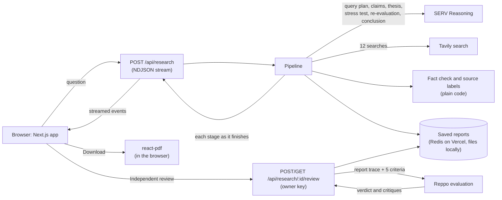

1. The browser posts the question; the API streams one event per stage back as NDJSON, so the report fills in live.
2. The pipeline ([src/lib/pipeline.ts](src/lib/pipeline.ts)) runs the stages in order and records an audit entry for each: model, duration, inputs, output and warnings.
3. Research ([src/lib/research/collect.ts](src/lib/research/collect.ts)) plans the searches, runs them, picks sources query by query, and has SERV extract facts; the fact check and source labels are plain code.
4. The reasoning stages ([src/lib/reasoning/stages.ts](src/lib/reasoning/stages.ts)) cite records by ID. Unknown IDs are removed and logged before anything is saved.
5. Reports are saved ([src/lib/store.ts](src/lib/store.ts)) in Redis on Vercel for 90 days, or as files when running locally, and reopen at `/research/:id`.
6. The review route ([src/app/api/research/[id]/review/route.ts](src/app/api/research/%5Bid%5D/review/route.ts)) builds the trace ([src/lib/reppo/payload.ts](src/lib/reppo/payload.ts)), submits it to Reppo, and saves the evaluation ID and, later, the verdict. It runs separately from the research, so it never slows down the original answer.

## Honest by design

A research tool is only useful if you can trust what it shows, so the rules below are enforced in code, with the prompts as a second layer.

| Rule | How it is enforced |
| --- | --- |
| Every fact is backed by its source's own words | SERV must quote each source it cites. [verify.ts](src/lib/research/verify.ts) checks each quote against the source text (ignoring case, spacing, curly quotes and dashes; `...` may skip words, in order). A source whose quote isn't found stops backing the fact; a fact with no quote found is dropped and counted in the summary |
| Figures must match | A figure a fact states (in digits) must appear in one of its quotes, as digits or words ("thirty-three" matches 33). If not, the fact is kept, flagged in the report, and passed to the later stages as unverified |
| The case against is always searched for | The query-plan schema requires 3 to 4 challenging searches. They run interleaved with the supporting ones, and sources are picked search by search in turn, so a supporting search's higher relevance scores can't crowd them out |
| A missing case against is called a gap, not proof | If no evidence against the answer survives, the later stages are told so explicitly, and the Evidence view says so |
| Original data comes first | The search plan aims at surveys, studies, official statistics and research firms. The first 4 searches run again limited to about 120 research, official and industry-report sites. Within each search, those sources are picked before news, and news before company sites and blogs |
| Weak sources count for less | Social posts and sources over three years old are flagged, only fill source slots the others leave open, and facts resting only on them are marked as weak evidence for the later stages and in the report |
| Citations can't dangle | Every ID a stage cites is checked against the records that exist. Unknown ones are removed and logged, so every audit-trail link leads somewhere |
| No assumption is skipped | The re-evaluation must judge every assumption; any it leaves out is recorded as unresolved |
| What changed is not rewritten | It's assembled from the recorded thesis, stress test and re-evaluation, not generated separately |
| Web text is untrusted | Excerpts are labelled as untrusted in every prompt and every call carries SERV's prompt guard |
| Reviews are deliberate | A Reppo review needs the owner key and consent ticked every time, and reviews are off unless `REPPO_REVIEW_ENABLED=1`. Keys stay on the server, and one report can only be submitted once, so visitors can never spend credits |
| A verdict is feedback, not proof | The review section says so, and Crux never presents a Reppo score as confirmation that the answer is true |

Two limits to be plain about: a fact's **stance** (for or against) and the **type** of an unrecognised source are the model's judgement, and the fact check proves the quote is real, not that the fact's wording is a perfect paraphrase beyond its figures.

## What was checked

- **Live runs with SERV and Tavily.** Five live runs of the crypto question on 26 September 2026. The balanced-research change took the evidence from 24 for and 0 against to a real case against (6 to 9 facts against in each later run). The stronger-sources change took the source mix from 13 company or blog sites out of 20 to 1, with research, official statistics and industry reports making up 12.
- **The report screenshots** are from the fifth run, shown exactly as it came back. 3 of the 31 extracted facts were dropped because their quotes weren't in the source text (one rested on a Statista page whose figures sit behind a paywall), and 1 is flagged because it states a sample size its quote doesn't contain.
- **Reppo, live.** The first evaluation request was accepted by Reppo and is awaiting its verdict. On the main site, the connection check reports Reppo connected (API key accepted) and Redis connected.
- **Unit tests** (`npm test`, 89 tests): quote verification, figures in digits and words, source labels and selection, balanced queries, ID and dash stripping, prompt-guard retries, the switch to sample data when credits run out, the full pipeline end to end, and the Reppo request, response parsing and owner-only access.
- **The UI in a real browser** (headless Chromium): every view at 320, 360, 390 and 1200 px, light and dark, no sideways scrolling, PDF downloads, the demo question by arrow key and by tap, and the Independent review link and tab from every view.
- **Type check, lint and production build** are clean (`npm run typecheck`, `npm run lint`, `npm run build`), and GitHub Actions runs all four on every pull request to `main`, without live API calls.

## Run it locally

You need [Node.js](https://nodejs.org) 22 or newer.

```bash
git clone https://github.com/Mhiah/crux.git
cd crux
npm install
cp .env.example .env.local   # then add SERV_API_KEY and TAVILY_API_KEY
npm run dev                  # open http://localhost:3000
```

Each question uses about 6 SERV calls and 12 Tavily searches and takes around a minute. Locally, reports are saved as files and reopen at `/research/:id`.

**On a phone:** keep the app running, connect the phone to the same Wi-Fi, and open the **Network** address that `npm run dev` prints (for example `http://192.168.0.3:3000`).

| Variable | Purpose |
| --- | --- |
| `SERV_API_KEY` | SERV Reasoning |
| `TAVILY_API_KEY` | Web search |
| `REPPO_API_KEY` | Reppo evaluation (server-side only) |
| `REPPO_REVIEW_ENABLED` | `1` turns on review requests; off by default |
| `CRUX_REVIEW_ACCESS_TOKEN` | The private owner key (24+ random characters) needed to request or check a review |
| `KV_REST_API_URL` + `KV_REST_API_TOKEN` | Redis storage on Vercel (added by the Upstash integration), or `UPSTASH_REDIS_REST_URL` + `UPSTASH_REDIS_REST_TOKEN` |
| `SERV_MODEL` | Model to use through SERV (default `gpt-5.4-mini`) |
| `SERV_SHADOW_AGENT` | `1` adds SERV's shadow-agent check to each stage (extra calls) |

Other commands:

```bash
npm run research -- "Should we launch an AI bookkeeping SaaS for Nigerian SMEs?"   # run from the terminal
npm run reppo:check # checks the Reppo key with a read-only call; never submits or spends credits
npm test            # unit tests
npm run typecheck
npm run lint
npm run build
```

## Deploy on Vercel

1. Import the GitHub repo in Vercel. The defaults (Next.js, `npm run build`) are right.
2. In **Settings → Environment Variables**, add `SERV_API_KEY` and `TAVILY_API_KEY` for Production. Your `.env.local` file is never uploaded, so without this step the app has no keys and shows the sample report.
3. For saved reports and Independent review: connect **Storage → Upstash Redis** to the project for Production (it adds the `KV_` variables), and add `REPPO_API_KEY`, `CRUX_REVIEW_ACCESS_TOKEN` and `REPPO_REVIEW_ENABLED=1`.
4. Redeploy (**Deployments → ⋯ → Redeploy**), because variables only apply to deployments made after they're added.
5. Check it at `/reppo-connect`: enter the owner key, and it confirms Reppo and Redis without submitting anything.

A run takes about a minute, and the research API allows up to 300 seconds. Without Redis, reports aren't saved and the Independent review tab stays hidden; use **Download** to keep a report. If SERV or Tavily credits run out, Crux shows the sample report instead, with a notice saying so.

## Project layout

```
src/
  app/
    page.tsx                  Home page and live results
    research/[id]/page.tsx    A saved report
    api/research/             POST a question (streams NDJSON), GET a saved run
    api/research/[id]/review/ Request a Reppo review, check for its verdict
    api/reppo/connection/     Owner-only Reppo and Redis connection check
    reppo-connect/page.tsx    The page for that check
    icon.svg                  Tab icon
  components/
    workstation.tsx           Answer, Reasoning, Evidence and Independent review views
    reppo-review.tsx          The Independent review panel
    report-pdf.tsx            The PDF report
    refs.tsx                  Audit-trail panel
    brand.tsx                 The CRUX wordmark
    site-header.tsx, theme-toggle.tsx, home-button.tsx
  lib/
    pipeline.ts               Runs the stages and records the audit trail
    reasoning/                SERV client, prompts, strict schemas, stages
    research/                 Search, source selection, fact check, source labels
    reppo/                    Reppo client, request builder, owner access, connection check
    store.ts                  Saved reports: Redis on Vercel, files locally
    plain.ts                  Turns cited IDs into plain sentences and Evidence links
    trace.ts                  Resolves any record to what it rests on and what uses it
    mock/                     Sample data for the tests
    types.ts                  The data model
tests/                        Vitest unit tests
docs/screenshots/             The images in this README
docs/S2_TASKS.md              Season 2 task tracker
```

## Known limitations

- **Evidence depth.** Each run reads up to 20 sources, and only the excerpt Tavily returns for each (up to 2,500 characters), not whole pages.
- **Judgement calls.** A fact's stance and the type of an unrecognised source come from the model. Recognised sites are labelled by address.
- **What the fact check proves.** That each quote really appears in its source, and that the fact's figures appear in it. It doesn't prove the fact's wording is a faithful summary beyond that.
- **Independent review is owner-only.** There are no user accounts yet, so one owner key controls reviews. Reppo's evaluators may see the submitted trace, so don't submit confidential research, and each review can use a Reppo credit.
- **Learning from the critique is next.** Today the verdict and critiques are shown and saved; turning them into targeted research and a measured revision is the next build.
- **SERV's prompt guard** occasionally blocks harmless requests. Blocks are retried up to twice; if a run still fails, running it again usually works.
- **One model.** Runs use `gpt-5.4-mini` through SERV unless `SERV_MODEL` is set; other models haven't been tested.
- **The PDF has no page numbers**, and doesn't include the Reppo verdict yet.
